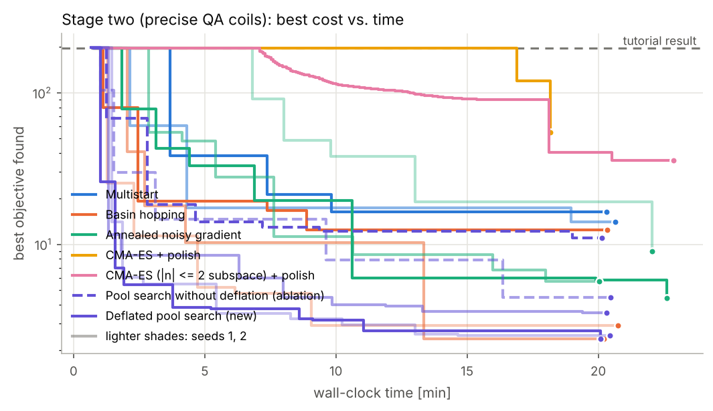
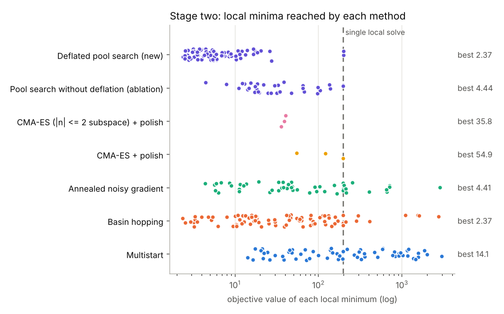
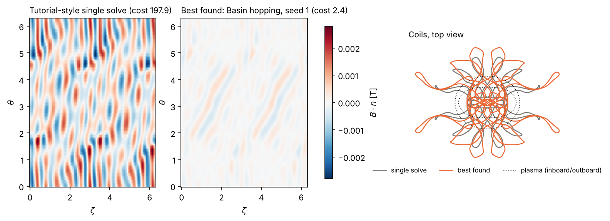
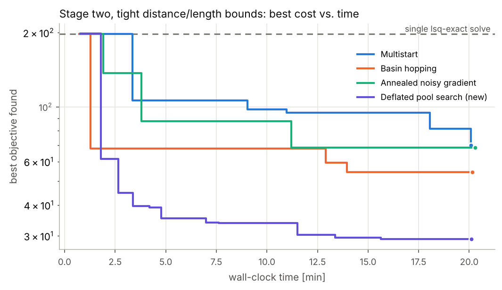
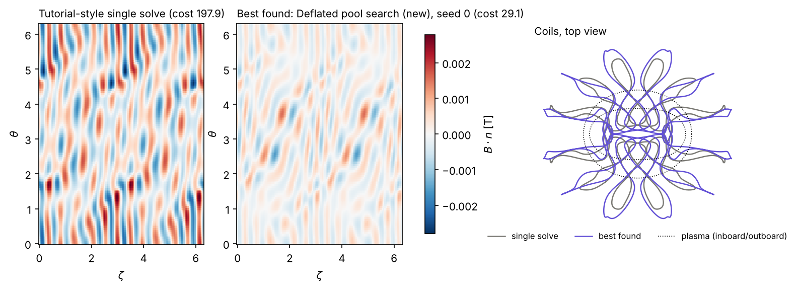
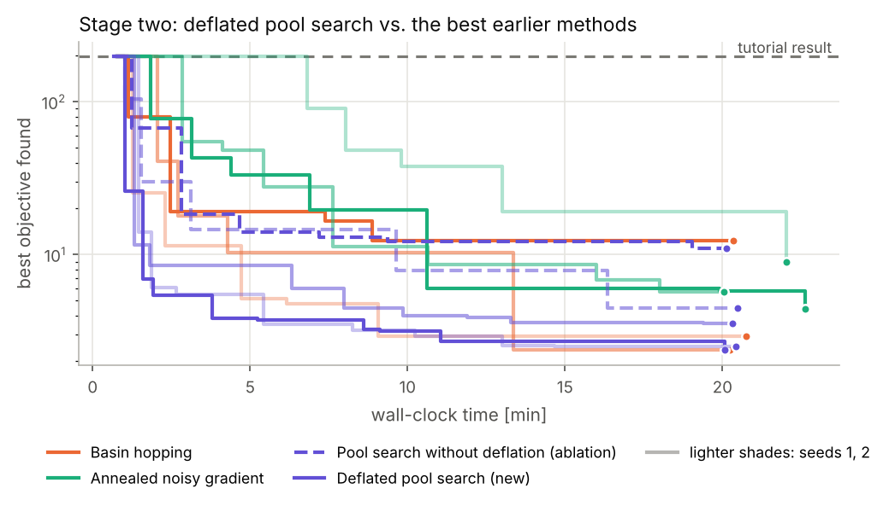
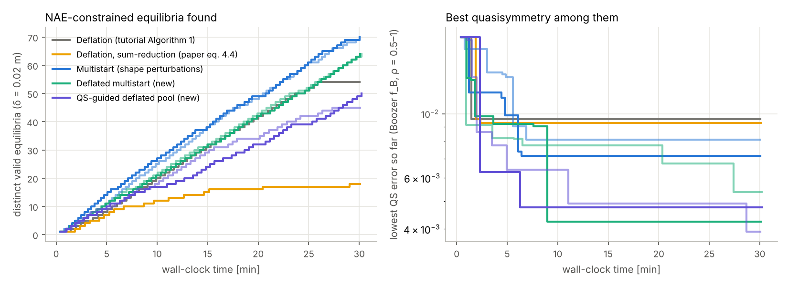
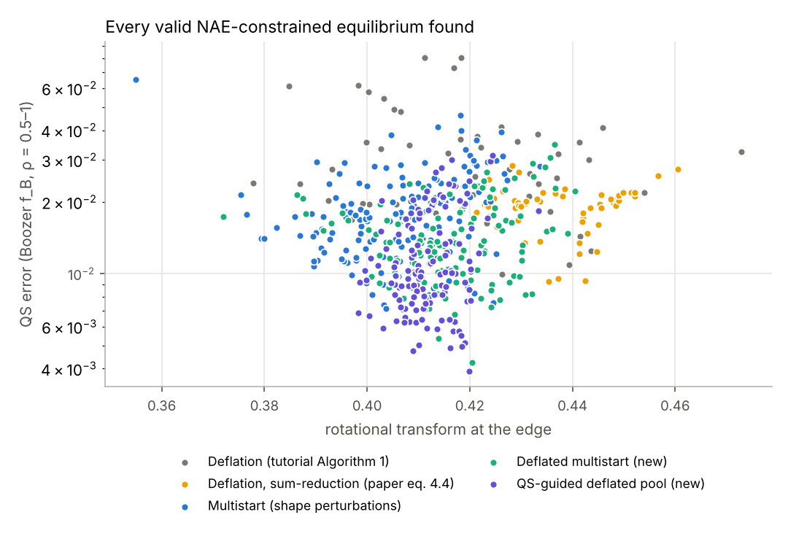
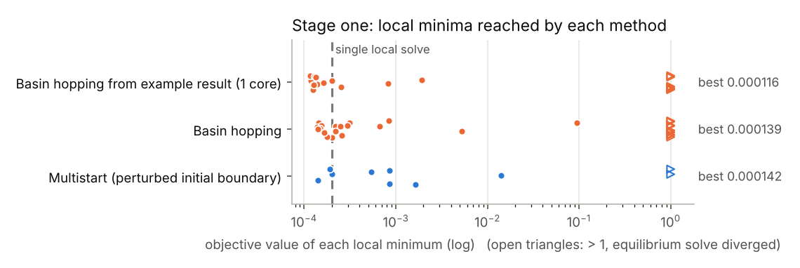

# Global / stochastic optimization for DESC stage-one and stage-two problems

DESC's optimizers (`lsq-exact`, `proximal-lsq-exact`, ...) are local trust-region
methods: they converge to the local minimum nearest the initial guess. This folder
adds global search strategies on top of them, and tests them on the optimization
examples that ship with DESC:

* **Stage two:** the first problem of
  `docs/notebooks/tutorials/coil_stage_two_optimization.ipynb`. That's 3 unique
  `FourierXYZCoil`s (N = 10) for the vacuum precise QA equilibrium, starting from
  circular coils, with the tutorial's exact objective, weights and constraints.
* **Stage one:** `desc/examples/precise_QA.py` (QS two-term + aspect ratio + iota,
  continuation over boundary modes with `proximal-lsq-exact`). It runs at reduced
  resolution (M = N = 6, boundary modes up to 3) so that many local solves fit in a
  CPU budget.
* **NAE-constrained equilibria:** the first problem of
  `docs/notebooks/tutorials/deflation.ipynb` (precise-QA near-axis constraints).
  It has many solutions and follows the deflation paper (Panici et al. 2026).

A second round used what the first round showed, together with the deflation
paper, to build a better method: **deflated pool search**. It was tested on the
coil problem, and its ideas were applied to the NAE-constrained problem.

All runs were made on 4 CPU cores (no GPU) with DESC master at commit `d644e62`.

## Results in brief

* **Stage two: global search finds far better coils.** The tutorial's single
  `lsq-exact` solve stops at cost **197.9**, and so does the same solve run to
  tight tolerances (197.87). That's a genuine local minimum, not an unconverged
  solve. Every global method beat it within 20 minutes on 3 CPU cores. The best,
  basin hopping, reached **2.37 (84× lower)**, with ⟨|B·n|⟩/⟨|B|⟩ =
  1.6e-4 instead of 9.2e-4. In the first round, the annealed noisy gradient was the
  most consistent method (4.4, 5.7 and 9.0 on its three seeds).
* **Round two: deflated pool search is consistently best on the coil problem.**
  It combines a pool of the best minima, small kicks with a deflated escape
  phase, and early abandonment of poor hops. Its three seeds ended at 2.37, 3.55
  and 2.51; the worst is better than the worst seed of basin hopping
  (12.4) and the noisy gradient (9.0). Without deflation the same
  search ended at 11.0 and 4.4.
* **NAE-constrained equilibria: different tools for different goals.** The
  tutorial's deflation spreads its solutions widest, but it stalls after about 55
  because its product-form operator overflows float64. A QS-guided deflated pool
  finds NAE-constrained equilibria with 2–2.5 times lower outer-volume QS error
  (best 3.9e-3 against 9.6e-3), and its whole population is 2.4 times better at
  the median.
* **Not just loose bounds.** The tutorial allows coils up to ~20 m long and as
  close as 5 cm, and the better minima use that freedom. So every method was
  rerun with **tight bounds** set to the tutorial result's own values: coil-coil
  distance ≥ 0.14 m, every coil ≤ 7 m. A single solve still ends at 197.9.
  Basin hopping reaches 54.5 (3.6× lower), and deflated pool search reaches
  **29.1 (6.8× lower)**, with ⟨|B·n|⟩/⟨|B|⟩ = 2.7e-4.
* **Stage one: smaller but real gains.** Against the example's continuation
  result (2.02e-4), multistart and basin hopping from scratch reach 1.39–1.43e-4
  (~30 % lower). Basin hopping started from the example's result reaches
  **1.16e-4 (43 % lower)**. The gain is almost entirely in the QS error; aspect
  ratio and ι stay on target.
* **Use deflated pool search (or basin hopping / the noisy gradient), not CMA-ES.** CMA-ES worked poorly
  in the ~190-dimensional coil space (54.9, or 35.8 restricted to |n| ≤ 2 modes).
  The methods built on DESC's exact-Jacobian local solver win.

## Stage two: precise QA coils (tutorial problem)

Every global run had the same 20-minute wall-clock budget on the same 3 cores.
"Local solves" counts the `lsq-exact` solves, each ~30–40 s. The objective is
the tutorial's, unchanged: cost = ½‖weighted residuals‖². In the better minima
it's almost entirely the quadratic-flux term.

| Method | Seed | Best cost | ⟨\|B·n\|⟩/⟨\|B\|⟩ | Min coil-coil [m] | Coil lengths [m] | Local solves |
|---|---|---|---|---|---|---|
| Tutorial (single `lsq-exact`) | – | 197.88 | 9.16e-4 | 0.144 | 6.97, 5.42, 5.52 | 1 |
| Same start, tolerances 1e-10 | – | 197.87 | 9.16e-4 | 0.144 | 6.97, 5.42, 5.52 | 1 |
| Multistart | 0 / 1 | 16.43 / 14.10 | 3.9e-4 / 2.9e-4 | 0.051 / 0.096 | ≤ 10.8 / ≤ 8.7 | 33 / 31 |
| Basin hopping | 0 / 1 | 12.38 / **2.37** | 3.2e-4 / **1.6e-4** | 0.050 / 0.051 | ≤ 11.5 / ≤ 12.3 | 31 / 33 |
| Annealed noisy gradient | 0 / 1 | 4.41 / 5.68 | 1.9e-4 / 1.9e-4 | 0.059 / 0.073 | ≤ 10.1 / ≤ 9.5 | 17 / 13 |
| CMA-ES + polish | 0 | 54.88 | 1.0e-3 | 0.051 | ≤ 12.4 | 4 |
| CMA-ES on \|n\| ≤ 2 modes + polish | 0 | 35.77 | 5.5e-4 | 0.050 | ≤ 10.3 | 4 |

A third seed of basin hopping and the noisy gradient, run later for the
round-two comparison, ended at 2.91 and 8.97 (see Round two).

Full per-term breakdown, curvature, plasma-coil distance and timings are in
[`results/summary.md`](results/summary.md).







What these show:

* **The landscape is very rugged.** Multistart's 64 local minima (two seeds)
  span 14 to 3000. Only about half beat the tutorial result, and the median is
  ~180. A single local solve from circular coils lands in one of these at
  random.
* **Good minima cluster.** Perturbing a good minimum and re-solving (basin
  hopping) gives lower minima than restarting from the initial guess: median
  41–63 vs 147–220 for multistart.
* **Langevin excursions work well.** The noisy-gradient excursions follow
  low-cost valleys instead of jumping isotropically. Their minima have medians
  of 14–33, and both seeds ended below 6, using only 13–17 local solves.
* **CMA-ES is a poor fit here.** Its generations of ~20 random samples in ~190
  dimensions rarely beat a local minimum of this narrow-valleyed objective.
  Searching only the |n| ≤ 2 modes helps, but it still loses to the methods that
  call the exact-Jacobian local solver.
* **Seed scatter is large.** Basin hopping got 12.4 on one seed and 2.4 on the
  other, so a single 20-minute run is one draw. If you have the hardware, run
  several seeds in parallel and keep the best.

### Same problem with tight distance/length bounds

The better minima above lengthen the coils (up to ~12 m vs 7 m) and push the
coil-coil distance down to the tutorial's bound (5 cm vs 14 cm). Both are
allowed by the tutorial's objective, but you may not want them. In
`--variant tight` the bounds are the tutorial result's own values: coil-coil
≥ 0.14 m and every coil ≤ 7 m. The tutorial result is therefore feasible, with
the same cost.

| Method | Seed | Best cost | Quadratic-flux term | ⟨\|B·n\|⟩/⟨\|B\|⟩ | Min coil-coil [m] | Coil lengths [m] | Local solves |
|---|---|---|---|---|---|---|---|
| Single `lsq-exact` (tutorial procedure) | – | 197.88 | 197.87 | 9.16e-4 | 0.144 | 6.97, 5.42, 5.52 | 1 |
| Multistart | 0 | 69.96 | 67.22 | 4.9e-4 | 0.138 | 7.06, 6.05, 6.94 | 32 |
| Basin hopping | 0 | **54.48** | 51.98 | **4.2e-4** | 0.137 | 7.05, 6.22, 6.96 | 31 |
| Annealed noisy gradient | 0 | 68.49 | 65.87 | 4.7e-4 | 0.137 | 7.05, 6.37, 6.18 | 17 |





The gain shrinks from ~80× to ~3–4×, but it is still large: ⟨|B·n|⟩/⟨|B|⟩ falls
2.2×. The bounds are soft penalties, as in the tutorial, so the minima sit just
past them (0.137 m instead of 0.14 m, 7.05 m instead of 7 m). Raise those terms'
weights if they must hold exactly.

## Round two: deflated pool search

### What the first round and the deflation paper suggested

* **Seed scatter.** One basin-hopping walker ended at 12.4 or 2.4 depending on
  the seed. A single walker is one draw.
* **Most local solves are wasted, but rarely on repeats.** A run's median
  minimum was 2.4–17 times worse than its best, while exact repeats were rare
  (0–2 per run). Avoiding known minima matters less than avoiding bad basins.
* **Deflation can replace big jumps.** Panici et al. (2026) push a solve away
  from known solutions with a deflation operator. Applied to hops, deflation
  can move a solve out of the parent's basin after only a small kick. Plain
  basin hopping needs kicks large enough to leave the basin, and those often land
  somewhere much worse.

### The method: `pool_search`

Each hop:

1. **Choose a parent** from a pool of the 4 best distinct minima, with
   probability ∝ exp(−rank).
2. **Kick it slightly**: σ starts at 0.3 perturbation-scale units and adapts
   toward a 30 % rate of entering the pool. Then run the first 20 iterations of
   `lsq-exact` **deflated** around the parent, the other pool members and the 4
   most recent minima. The penalty is `ScaledDeflation`: zero outside an RMS
   radius of 3σ around every center, growing without bound inside it. This is the
   sum-reduction deflation constraint of the paper, eq. (4.4), applied as a
   least-squares penalty.
3. **Race**: if the undeflated cost after that phase is more than 3 times the
   worst pool member, abandon the hop.
4. **Polish** the survivors without deflation, so every pool member is a true
   local minimum of the original problem.

`ScaledDeflation` keeps its centers, weight and radius as array attributes. DESC
objectives are pytrees, so these are dynamic leaves: changing them between solves
does not recompile anything, and with zero weight the term contributes exactly
nothing.

### Results: 20 minutes per run on the same 3 cores

| Method | Seed 0 | Seed 1 | Seed 2 | Worst seed |
|---|---|---|---|---|
| Multistart | 16.43 | 14.10 | – | 16.43 |
| Basin hopping | 12.38 | 2.37 | 2.91 | 12.38 |
| Annealed noisy gradient | 4.41 | 5.68 | 8.97 | 8.97 |
| CMA-ES + polish | 54.88 | – | – | 54.88 |
| Pool search without deflation (ablation) | 10.99 | 4.44 | – | 10.99 |
| **Deflated pool search** | **2.37** | **3.55** | **2.51** | **3.55** |



* **Consistent.** All three seeds ended between 2.37 and 3.55, with
  ⟨|B·n|⟩/⟨|B|⟩ = 1.6–1.8e-4. The best result equals the best single run of the
  first round (2.37), and the worst seed beats the worst seed of every earlier
  method. Basin hopping can do as well on a good seed (2.37 and 2.91 on two of
  its three), but not reliably: its third seed ended at 12.4.
* **Deflation is what makes it work.** With deflation off (and the larger
  basin-hopping kicks), the same pool-and-racing search ended at 11.0 and 4.4.
  Deflated hops started from kicks of only 0.3–0.7 scale units, yet landed a
  median 2.8 units from their parent: deflation, not a random jump, carried them
  into a neighboring basin.
* **Racing saves solves.** After the first 20 iterations the cost is usually
  within a few percent of the polished value (median 0.1–3 %), so the race is a
  reliable early test. 4–9 of 25–44 hops per run were abandoned there, and none
  of the 76 polished hops returned to a pool member.
* **Tight bounds.** With coil–coil distance ≥ 0.14 m and coils ≤ 7 m, pool search
  reached **29.1** (⟨|B·n|⟩/⟨|B|⟩ = 2.7e-4). The best earlier method reached
  54.5 and a single solve 197.9. The gain over a single solve grows from 3.6×
  to 6.8×.

## NAE-constrained equilibria (the deflation tutorial problem)

**Problem.** This is the first section of
`docs/notebooks/tutorials/deflation.ipynb`, which follows the deflation paper.
The global equilibrium is constrained to the axis and O(ρ) behaviour of the
first-order precise-QA near-axis solution (pyQSC), at the tutorial's resolution:
L = M = 5, N = 6, initial surfaces from the NAE at r = 0.25.

Minimizing force balance under these linear constraints is under-constrained, so
there are many solutions. Every candidate is re-solved as a fixed-boundary
equilibrium, as in the tutorial, and counted as **valid** if both force errors are
below 1 %.

The NAE guarantees quasisymmetry only near the axis. The outer surfaces differ
between solutions, so the figure of merit is the Boozer QS error f_B averaged over
ρ = 0.5, 0.75 and 1: "better" means a lower value.

**Methods.** `nae_global.py` runs each method for 30 minutes on one CPU core:

| Method | What it does |
|---|---|
| Deflation, tutorial | The tutorial's Algorithm 1: deflated solve from the same initial guess each time (`DeflationOperator`, M·f, p = 2, σ = 500, product over all solutions, on the boundary coefficients), then the NAE solve, then the fixed-boundary solve |
| Deflation, sum form | The same with the paper's sum-reduction operator, eq. (4.4) |
| Multistart | Smooth random perturbations of the initial guess, then the NAE solve. Only Zernike modes vanishing as ρ² or faster at the axis are perturbed: perturbing all modes produced non-nested surfaces that never converged |
| Deflated multistart | Multistart whose first 15 iterations are deflated around every solution found so far (`ScaledDeflation`, nearest-center form) |
| QS-guided deflated pool | Pool search on the QS figure of merit: kick one of the 5 best-QS solutions, deflate around every known solution, re-solve |

**Results.** Distinct means boundary coefficients more than δ apart (L2 norm, m)
from every solution counted before.

| Method | Seed | Valid | Distinct, δ = 0.02 / 0.04 | Best QS error | Median QS error | ι edge range |
|---|---|---|---|---|---|---|
| Deflation, tutorial | – | 68 | 54 / **39** | 9.6e-3 | 2.4e-2 | **0.378–0.473** |
| Deflation, sum form | – | 58 | 18 / 6 | 9.3e-3 | 2.0e-2 | 0.421–0.460 |
| Multistart | 0 / 1 | 75 / 73 | 70 / 32–36 | 7.1e-3 / 8.2e-3 | 1.7e-2 | 0.355–0.434 |
| Deflated multistart | 0 / 1 | 68 / 67 | 64 / 17–22 | 4.2e-3 / 5.4e-3 | 1.3–1.5e-2 | 0.372–0.440 |
| QS-guided deflated pool | 0 / 1 | 69 / 67 | 45–50 / 10 | **4.8e-3 / 3.9e-3** | **1.0e-2** | 0.398–0.433 |





* **The tutorial's deflation spreads solutions widest** (39 distinct at
  δ = 0.04, ι at the edge from 0.38 to 0.47). But it **stops finding new
  solutions after about 55**. Every factor of its product-form operator is at
  least σ = 500, so with ~55 deflated states the squared deflated cost passes
  10³⁰⁸ and overflows float64. The deflated solve then fails, and every later
  iteration returns the first solution again. Computing the product in log space
  would fix this. So would the sum form, but at σ = 500 that form deflates too
  weakly here, and most of its solutions were near-duplicates (18 distinct of
  58 at δ = 0.02).
* **Random starts find more solutions per minute.** Shape-perturbed multistart
  found 73–75 valid equilibria per half hour (70 distinct at δ = 0.02), but
  closer together than deflation's.
* **The QS-guided pool finds better equilibria.** Its best solutions have
  2–2.5 times lower outer-volume QS error than the tutorial deflation's best
  (3.9e-3 and 4.8e-3 against 9.6e-3), and its whole population is 2.4 times
  better at the median (1.0e-2 against 2.4e-2). As designed, it searches near
  good solutions, so its solutions are less spread out (10 distinct at
  δ = 0.04).
* **What to use when.** To map the family of equilibria, use deflation, with the
  overflow fixed. To pick the best equilibrium for a later stage-one
  optimization, use the QS-guided pool, or deflated multistart for a balance of
  spread and quality.

## Stage one: precise QA boundary (reduced resolution)

Each run used 1 CPU core and a budget of at most 1 hour (the last column is wall time).
Each local optimization is a `proximal-lsq-exact` solve, which re-solves the
equilibrium; one takes 1.5–7 min (a full k = 1..3 continuation).

| Method | Best cost | QS term | Aspect ratio | ι (edge) | Local optimizations | Wall [s] |
|---|---|---|---|---|---|---|
| Example (continuation k = 1, 2, 3) | 2.02e-4 | 1.97e-4 | 6.000 | 0.420 | 1 | 636 |
| Multistart (perturbed initial boundary + continuation) | 1.43e-4 | 1.36e-4 | 6.000 | 0.419 | 11 | 3650 |
| Basin hopping (runs the example, then hops) | 1.39e-4 | 1.38e-4 | 6.000 | 0.420 | 29 | 3696 |
| Basin hopping from the example's saved result (exploratory, seed 1) | **1.16e-4** | 1.13e-4 | 6.000 | 0.419 | 21 | 2541 |




The gains are tens of percent, not orders of magnitude, so stage one's landscape
looks much less rugged at this resolution. Global search is also costlier per
step there: each local solve takes minutes. Large boundary perturbations
sometimes make the equilibrium solve diverge (the open triangles in the figure).
Those trials are rejected automatically, but they waste time, so keep
`--sigma`/`--length-scale` moderate.

## Caveats

* **Coil rotation and shift are left free.** The stage-two runs optimize
  each coil's `rotmat` and `shift` along with its Fourier coefficients. DESC's
  `Optimizer.optimize` would fix them (`FixCurveRotation`, `FixCurveShift`). They
  are redundant with the Fourier coefficients, so the reachable coil shapes are
  the same, and every stage-two run uses the same setting.
* **The NAE runs used one core each,** at the tutorial's low resolution, with
  one or two seeds. Their seed-0 runs ran alongside stage-two runs, and the
  seed-1 runs and the sum-form run ran four at a time. Rates are comparable to
  within about 10 %.

* **CPU only.** All timings are from 3–4 CPU cores. On a GPU each local solve is
  faster, so more of them fit in the same budget. The ranking of the methods
  should not change.
* **Few seeds.** Stage-two methods ran 2 seeds each; the tight variant and CMA-ES
  ran 1, stage one 1. The differences between multistart, basin hopping and the
  noisy gradient are within seed scatter. Only "all of them ≫ single solve" and
  "CMA-ES worst" are robust conclusions.
* **Curvature bound everywhere.** Every stage-two solution, including the
  tutorial's, has its maximum curvature at the bound (2.0, normalized).
* **Reduced stage-one resolution.** Stage one ran at M = N = 6 with boundary
  modes up to 3, instead of M = N = 8 and 4 continuation steps. The minima at
  full resolution may differ.
* **A failed first design.** The first version of the noisy gradient (pure
  annealed Langevin dynamics from the circular coils) failed, ending at 208. It
  is kept in `results/stage2/superseded/` for reference. The current version
  starts each excursion from the incumbent local minimum and always finishes with
  a local solve.

## Using this on your own problems

The tools work for any DESC problem whose constraints are linear: coil
optimization, fixed-boundary optimization with `lsq-exact`, and so on:

```python
from desc_global import ProjectedProblem, basin_hopping, multistart, annealed_noisy_gradient

problem = ProjectedProblem(
    coilset, objective, constraints,
    local_kwargs=dict(maxiter=100, ftol=1e-4),
    length_scale=0.05,   # ~10% of a typical coil radius, in meters
    alpha=0.5,           # smoothness: scale of mode n is length_scale * exp(-alpha * n)
    current_rel=0.1,
)
res0 = problem.local_solve(problem.x_full())           # the usual single solve
result = basin_hopping(problem, x0=res0["x"], sigma=1.0, temperature=0.5,
                       restart_after=6, time_budget=3600)
# or the round-two method (build the problem with deflation_slots=8):
# result = pool_search(problem, x0=problem.x_full(), time_budget=3600)
# or: annealed_noisy_gradient(problem, x0=res0["x"], temperature0=0.3, time_budget=3600)
coilset.save("best_coils.h5")                           # coilset now holds the best found
```

* With many Fourier modes, keep perturbations smooth. For example, for a coilset
  with 20 coils × 151 modes each, use a larger `alpha` or
  `max_order=...` (perturb only |n| ≤ max_order). Otherwise each hop is mostly
  high-frequency noise that the local solve has to undo.
* Multistart and independent basin-hopping seeds are embarrassingly parallel:
  run one process per GPU or core and keep the best.
* After a big improvement, check the per-term breakdown. In the tutorial
  objective the better minima come partly from longer, closer-packed coils.
  Decide whether that's acceptable, and tighten the bounds or raise the weights
  if not.
* For equilibrium (stage-one / free-boundary) problems, `ForceBalance` needs
  `ProximalProjection`, which `ProjectedProblem` does not wrap. Follow
  `stage1_precise_QA.py` instead: perturb with `Equilibrium.perturb` and re-run
  `eq.optimize`.

## Files

| File | What it is |
|---|---|
| `desc_global.py` | Library: `ProjectedProblem` wrapper plus `multistart`, `basin_hopping`, `cma_es`, `annealed_noisy_gradient` |
| `stage2_precise_QA.py` | Stage-two driver (tutorial problem), one method per call |
| `run_stage2_all.sh` | Runs stage-two methods in sequence with the same budget and cores (`BUDGET`, `SEED`, `METHODS`, `EXTRA="--variant tight"`) |
| `stage1_precise_QA.py` | Stage-one driver (precise QA example): baseline / multistart / basin hopping |
| `run_stage1_all.sh` | Same for stage one |
| `nae_global.py` | NAE-constrained equilibria (deflation tutorial problem): tutorial deflation, sum-form deflation, multistart, deflated multistart, QS-guided pool |
| `analyze.py` | Builds `results/summary.md` and `figures/` |
| `results/stage2/*.json`, `*_coilset.h5` | Per-run summaries (cost trace, every local minimum found, metrics) and the best coilsets; `*_tight_*` = tight-bounds variant |
| `results/stage1/*.json`, `*_eq.h5` | Same for stage one, with the best equilibria |
| `results/nae/*.json`, `*.npz` | Every NAE-constrained equilibrium found: metrics (force error, ι, aspect ratio, Boozer f_B(ρ), magnetic well) and boundary coefficients |
| `results/*/logs/` | Run logs (not committed) |
| `results/stage2/superseded/` | First (failed) noisy-gradient design, kept for reference |

## How the global search works

### Build once, solve many times

Each restart has to reuse the JIT-compiled residual and Jacobian, otherwise every
local solve pays the objective build + compile cost again. `ProjectedProblem`
builds the `ObjectiveFunction` and the `LinearConstraintProjection` once.
`Optimizer.optimize` accepts that prebuilt projection directly, so every local solve
is just "write a new state into the coils, call `lsq-exact`".

```python
from desc_global import ProjectedProblem, multistart, basin_hopping

problem = ProjectedProblem(
    coilset, objective, constraints,          # same objects you'd pass to Optimizer
    local_method="lsq-exact",
    local_kwargs=dict(maxiter=100, ftol=1e-4),
    length_scale=0.05,                        # perturbation size for Fourier coeffs [m]
    alpha=0.5,                                # spectral decay exp(-alpha * |n|)
    current_rel=0.1,                          # perturbation of currents, relative
)
result = multistart(problem, n_starts=30, sigma=1.0, time_budget=1200)
coilset  # now holds the best coils found; result.cost, result.history, result.trace
```

### Perturbations are smooth, mode-aware and constraint-consistent

`perturbation_scales` gives each Fourier coefficient of a curve or surface a scale
`length_scale * exp(-alpha * k)`, where `k` is the mode order. Random perturbations
are therefore smooth geometric deformations, not high-frequency noise. Currents get
`current_rel * mean|I|`. `rotmat`, `shift`, profiles and the equilibrium interior
are not perturbed. Any parameter can be overridden by name. Every trial point is
orthogonally projected onto the linear constraints, so `FixCoilCurrent`,
`FixParameters`, etc. stay satisfied.

### Strategies

| Function | Idea | Notes |
|---|---|---|
| `multistart` | Independent local solves from random perturbations of the initial guess | Embarrassingly parallel; also maps out the distribution of local minima |
| `basin_hopping` | Perturb the incumbent minimum, solve locally, Metropolis accept on `log(cost)`, adapt step size towards ~40 % acceptance, restart from the best after repeated failures | Exploits the structure near good minima |
| `cma_es` | CMA-ES on the raw objective (each generation is evaluated in one `vmap`-ed call), then `lsq-exact` polishing of the best candidates | Derivative-free; best used around an existing local minimum |
| `pool_search` | Pool of the best distinct minima; small kicks with a deflated first phase (`ScaledDeflation`), early abandonment of poor hops, undeflated polish | Round-two method; the most consistent on the coil problem |
| `annealed_noisy_gradient` | Langevin-driven basin hopping: from the incumbent minimum, run Adam in the projected variables with smooth noise annealed to 0 over the cycle, then polish with `lsq-exact` and keep the result if it is better | The excursions follow low-cost valleys instead of jumping isotropically; most consistent method in the stage-two tests |

The stage-one driver uses the same idea at the level of `Equilibrium.optimize`. The
boundary is perturbed with `Equilibrium.perturb` (modes up to the current k, major
radius untouched), and `ProximalProjection` re-solves force balance before each
local optimization.

## Reproducing

```bash
pip install -e . cma            # from the DESC repo root
cd global_opt
# stage two: 20 min per method on 3 cores
./run_stage2_all.sh                                        # seed 0, all methods
SEED=1 METHODS="multistart basin noisy" ./run_stage2_all.sh
python stage2_precise_QA.py --method cma --max-order 2 --tag _lowmode
EXTRA="--variant tight" LOGTAG=_tight METHODS="baseline multistart basin noisy" ./run_stage2_all.sh
# stage one: 1 core, 1 h per method
python stage1_precise_QA.py --method baseline
python stage1_precise_QA.py --method multistart --budget 3600
python stage1_precise_QA.py --method basin --budget 3600
python stage1_precise_QA.py --method basin --budget 2400 --seed 1 --tag _explore \
    --init results/stage1/baseline_M6_k3_seed0_eq.h5
SEED=0 METHODS="pool pool_nodefl" ./run_stage2_all.sh   # also SEED=1, 2
EXTRA="--variant tight" LOGTAG=_tight METHODS="pool" ./run_stage2_all.sh
# NAE-constrained equilibria: 30 min on one core each
for m in deflation deflation_sum multistart defl_multistart qs_pool; do
  taskset -c 3 python nae_global.py --method $m --budget 1800 --seed 0
done
python analyze.py --fields
```

Runs write their JSON summary and best result when they finish. The stage-one
driver also checkpoints after every improvement.
